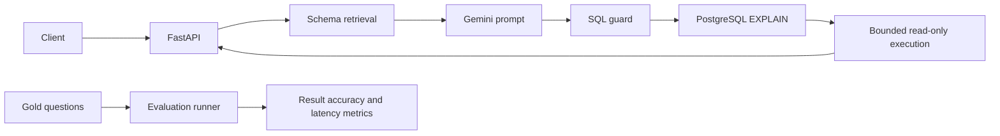

# SchemaDrill

SchemaDrill is a PostgreSQL text-to-SQL service. It retrieves the relevant database
schema, asks Gemini to generate a read-only query, validates that query with a
deterministic SQL guard and PostgreSQL `EXPLAIN`, then executes it with bounded retries.
The repository also contains a reproducible evaluation harness and a small React client.

## What is implemented

- FastAPI query API with structured results and OpenAPI documentation
- PostgreSQL/pgvector schema retrieval with optional foreign-key expansion
- Gemini SQL generation with bounded, stateless self-correction
- SQL allowlisting, table-scope checks, blocked-function checks, and result-row limits
- Read-only PostgreSQL execution and structured telemetry
- Redis request rate limiting, concurrency admission, and provider retry controls
- Neon Auth (Google) JWT verification and per-user dataset provisioning
- Cloud Build CI/CD that gates deploys on pytest and a live 100% Chinook evaluation
- React/Vite frontend served by the same container
- Chinook regression fixtures and BIRD Mini-Dev evaluation support
- Evaluation metrics for result-set accuracy, execution success, AST similarity,
  retries, token usage, stage timing, and mean/median/p95 latency

The checked-in Chinook fixture is deterministic and intended for smoke tests. BIRD
Mini-Dev is external and must be downloaded separately. See
[evaluation/bird/README.md](evaluation/bird/README.md).

## Architecture



The full system diagram, request sequence, data model, CI/CD flow, and decision log are in
[docs/architecture.md](docs/architecture.md).

## Documentation

| Doc | Contents |
| --- | --- |
| [docs/architecture.md](docs/architecture.md) | Diagrams, architectural decisions (ADR log), known gaps, target architecture |
| [docs/changelog.md](docs/changelog.md) | Shipped features timeline and bugs solved, from git history |
| [docs/roadmap.md](docs/roadmap.md) | Planned work: connect your Neon database, multi-provider BYOK, run SQL on your own DB, CSV/PDF export, uploads |
| [docs/solution-design.md](docs/solution-design.md) | Initial technical approach for each planned problem: encryption, isolation, SSRF, dead credentials, multi-LLM, uploads |
| [docs/wiki/connect-neon.md](docs/wiki/connect-neon.md) | How to copy your Neon connection string, create a read-only role, and how long it is kept |
| [docs/wiki/byok-keys.md](docs/wiki/byok-keys.md) | How to add Gemini, Claude, and GPT keys, and what happens when one expires or runs out |
| [docs/why-no-neon-oauth.md](docs/why-no-neon-oauth.md) | Why this free project does not use Neon OAuth |
| [docs/modules.md](docs/modules.md) | Module map |
| [docs/implementation-notes.md](docs/implementation-notes.md) | Technical history of retry, pipeline, and evaluation work |

## Roadmap summary

Next iteration: **Sign in with Google, connect your Neon database, bring your own LLM key (BYOK),
pick a dataset, and ask in natural language.** Google sign-in (via Neon Auth) and curated-dataset
querying are already live. Connecting your own Neon database (by connection string),
multi-provider BYOK, and user-owned databases are planned.
See [docs/roadmap.md](docs/roadmap.md).

## Local development

Requirements: Docker with Compose, Python 3.12, Node.js 20 for frontend development,
and a Gemini API key for live generation.

```sh
cp .env.example .env
# Set GEMINI_API_KEY in .env.
docker compose up -d --build
docker compose ps
curl --fail http://localhost:8000/health
```

The database seed creates the Chinook fixture. Ingest its schema embeddings once:

```sh
docker compose exec app python -m ingest.schema_ingest chinook
```

Use the API:

```sh
curl -X POST http://localhost:8000/query \
  -H 'Content-Type: application/json' \
  -d '{"db":"chinook","question":"List the names of all artists."}'
```

Open <http://localhost:8000/> for the frontend or <http://localhost:8000/docs> for
Swagger. For frontend-only development:

```sh
cd frontend
npm install
npm run dev
```

The public health indicator does not require sign-in. The first authenticated request
creates the user record and provisions the default datasets idempotently. Add
`http://localhost:8000` (or `http://localhost:5173` for Vite) to the Neon Auth trusted
origins if Google sign-in is being tested locally. `NEON_AUTH_ISSUER` must be the Neon
Auth host URL; `NEON_AUTH_JWKS_URL` includes the `/neondb/auth/.well-known/jwks.json`
path.

## Evaluation and ablations

The evaluator compares generated and gold SQL by executing both against the same
database. Result-set accuracy is the primary correctness metric: row order is ignored,
duplicate rows and `NULL` values are preserved, numeric representations are normalized,
and column order remains significant. AST similarity is reported separately as a
diagnostic. Timing fields measure the actual run; they are not claims about a fixed
production SLA.

Run the deterministic Chinook evaluator without Gemini:

```sh
docker compose run --rm app \
  python -m evaluation.runner --gold-as-generated --dataset chinook
```

Run a live benchmark:

```sh
docker compose exec app python -m eval.run_benchmark \
  --questions eval/questions.json \
  --dataset chinook \
  --output /tmp/schemadrill-results.jsonl
```

Run the retry and foreign-key retrieval ablation matrix:

```sh
docker compose exec -T app python -m eval.run_benchmark_matrix \
  --questions eval/questions.json \
  --db chinook \
  --output-dir /tmp/schemadrill-ablation
docker compose cp app:/tmp/schemadrill-ablation ./benchmark-results
```

The matrix compares four independently recorded configurations:

1. no retry, no foreign-key expansion
2. retry, no foreign-key expansion
3. no retry, foreign-key expansion
4. retry, foreign-key expansion

Each report includes result-set accuracy, SQL execution success, retries, token usage
when available, stage timings, and mean/median/p95 elapsed time.

To repeat every configuration three times and include the full-schema baseline:

```sh
docker compose run --rm app python -m evaluation.run_benchmark \
  --questions evaluation/chinook/cases.json \
  --dataset chinook \
  --matrix \
  --repetitions 3 \
  --gold-as-generated \
  --output-dir /tmp/schemadrill-ablation
```

`full_schema` reads every stored table DDL directly and does not embed the question.
The other configurations use the pgvector top-k path. The repeated JSONL files and
summary metadata are kept separately so run-to-run variance is visible.

### BIRD Mini-Dev

BIRD is not bundled because its license and database dumps are external. After placing
the standard split at `evaluation/bird/dev.json` and loading the corresponding schemas
into the configured PostgreSQL instance:

```sh
python -m evaluation.runner \
  --bird-root evaluation/bird \
  --split dev \
  --gold-as-generated
```

For live generation and JSONL output:

```sh
python -m evaluation.runner \
  --bird-root evaluation/bird \
  --split dev \
  --output benchmark-results/bird-dev.jsonl
```

The loader accepts the standard BIRD fields `question`, `evidence`, `SQL`, and `db_id`.
The BIRD databases must be available to the configured connection; the loader does not
silently convert or invent database fixtures.

## Google Cloud Run

The Dockerfile builds the frontend and serves it from FastAPI. Cloud Run supplies
`PORT`, while local Compose continues to use port 8000. Use a managed PostgreSQL
service with pgvector, such as Neon, for the runtime database; Cloud Run does not
provide PostgreSQL.

Prepare the remote database by applying [scripts/init.sql](scripts/init.sql),
[scripts/load_demo_dbs.sql](scripts/load_demo_dbs.sql), and schema ingestion:

```sh
INGEST_DATABASE_URL="$REMOTE_ADMIN_DATABASE_URL" \
  .venv/bin/python -m ingest.schema_ingest chinook
```

Deploy from the repository root:

```sh
gcloud auth login
gcloud config set project YOUR_PROJECT_ID
gcloud config set run/region asia-south1
gcloud run deploy schemadrill \
  --source . \
  --region asia-south1 \
  --allow-unauthenticated \
  --memory 2Gi \
  --cpu 1 \
  --min 0 \
  --max 2 \
  --timeout 300
```

Configure `DATABASE_URL`, `GEMINI_API_KEY`, `MODEL_NAME`, `EMBEDDING_MODEL`, retrieval
settings, and Redis settings on the service. Store credentials in Secret Manager rather
than in the image or repository. A shared managed Redis instance is required for
consistent rate limiting across multiple Cloud Run instances; set `REDIS_FAIL_OPEN`
deliberately if availability should take precedence over enforcement during Redis
outages.

Verify the deployment:

```sh
curl --fail https://YOUR_SERVICE_URL/health
curl --fail https://YOUR_SERVICE_URL/
curl --fail https://YOUR_SERVICE_URL/query \
  -H 'Content-Type: application/json' \
  -d '{"db":"chinook","question":"List the names of all artists."}'
gcloud run services logs read schemadrill --region asia-south1 --limit 100
```

The embedding model is preloaded during application startup by default, so the first
query does not pay the model-load cost. Set `PRELOAD_EMBEDDING_MODEL=false` only when
you prefer faster container startup over predictable first-query latency. Gemini is a
remote provider and is not locally warmable; the first request can still include
provider/network latency. Configure a billing alert and keep the minimum instance count
at zero for a low-traffic demo.

## Quality checks

The CI workflow runs Ruff, Black, the Python tests, frontend build checks, Docker
validation, pgvector smoke tests, and deterministic Chinook evaluation. BIRD remains an
explicit manual or scheduled evaluation because its data and database setup are not
checked into the repository.

```sh
python -m pytest -q
ruff check .
black --check .
```

If the repository virtual environment is present, use `.venv/bin/python` or activate it:

```sh
source .venv/bin/activate
python -m pytest -q
```

### Authentication

The API protects query, dataset, and metrics routes with Neon Managed Auth JWTs.
Configure `NEON_AUTH_JWKS_URL`, `NEON_AUTH_ISSUER`, and `NEON_AUTH_AUDIENCE` for
the backend, and `VITE_NEON_AUTH_URL` for the frontend. Enable Google as a
provider in Neon Auth and add each deployed frontend origin to its trusted
domains. `/health` remains public for Cloud Run health checks.

### BYOK (Bring Your Own Key) & Tiers

Signed-in users can run queries on the built-in **Free tier** (using the server's
Gemini key) or supply their own Gemini API key (**BYOK**) for higher limits, model
selection, and optional model fallback.

| Feature | Free tier (no key) | BYOK (`X-LLM-Api-Key`) |
| --- | --- | --- |
| Rate limits | `FREE_TIER_HOURLY_LIMIT=5`/hr, `FREE_TIER_DAILY_LIMIT=15`/day, `FREE_TIER_GLOBAL_DAILY_LIMIT=300`/day | `BYOK_RATE_LIMIT_PER_MINUTE=30`/min |
| Redis outage behavior | Fails closed (`503`) | Follows `REDIS_FAIL_OPEN` |
| No-Redis fallback | In-process fixed-window limiter (never unlimited) | In-process fixed-window limiter |
| Model selection | Fixed (`FREE_TIER_MODEL` or `MODEL_NAME`) | Any `generateContent` model validated for your key |
| Fallback model | Disabled | Optional sticky fallback on provider exhaustion |
| Retry budget | Capped (`FREE_TIER_MAX_RETRIES=2`, `FREE_TIER_PROVIDER_MAX_ATTEMPTS=2`) | Full (`max_retries` up to 3, `PROVIDER_MAX_ATTEMPTS`) |

#### Entering your API key

1. Sign in with Google in the SchemaDrill UI and click the tier badge (e.g. **Free tier**)
   or **Add your key to use your own quota** to open **LLM API Key Settings**.
2. Paste your Gemini API key (for example from Google AI Studio, `AIza...`) into the
   password-masked input and click **Validate** (`POST /api/llm/validate`).
3. Choose your **Primary model** and an optional **Fallback model** from the list
   fetched with your key.
4. For direct API calls, pass `X-LLM-Api-Key: <your-key>` (and optional
   `X-LLM-Provider: gemini`) as HTTP headers on `/api/llm/validate` and `/query` —
   never in the JSON body or URL.

#### Security model (Phase 1)

- **Never stored on the server, never logged:** Your key is wrapped in `SecretStr` on
  entry, used only to build a per-request client, and redacted from logs and traces;
  it transits server memory per request only.
- **Browser `sessionStorage` only:** The SPA holds the key in module memory mirrored
  to `sessionStorage` so it survives a refresh in the same tab. It is never written
  to `localStorage`, cookies, IndexedDB, or URLs, and is cleared on **Clear key**,
  sign-out, cross-tab `SIGNED_OUT`, or a `403 invalid_llm_key` response.

#### BYOK & Tiering environment variables

| Variable | Default | Purpose |
| --- | --- | --- |
| `FREE_TIER_MODEL` | `""` (falls back to `MODEL_NAME`) | Model used for free-tier queries |
| `FREE_TIER_HOURLY_LIMIT` | `5` | Per-user free-tier hourly cap |
| `FREE_TIER_DAILY_LIMIT` | `15` | Per-user free-tier daily cap |
| `FREE_TIER_GLOBAL_DAILY_LIMIT` | `300` | Global daily free-tier cap across all users |
| `FREE_TIER_MAX_RETRIES` | `2` | Max SQL self-correction retries on free tier |
| `FREE_TIER_PROVIDER_MAX_ATTEMPTS` | `2` | Max provider retry attempts on free tier |
| `BYOK_RATE_LIMIT_PER_MINUTE` | `30` | Per-user BYOK requests per minute |
| `KEY_VALIDATE_LIMIT` | `5` | Per-user `/api/llm/validate` calls per minute |
| `LLM_KEY_FINGERPRINT_PEPPER` | `""` | Server pepper for HMAC-SHA256 model-list cache keys |
| `QUERY_DEADLINE_SECONDS` | `90.0` | End-to-end monotonic query deadline |
| `MAX_TOTAL_PROVIDER_CALLS` | `12` | Max total provider calls per request (including fallback) |
