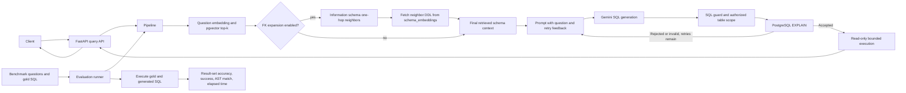

# SchemaDrill

I built SchemaDrill to let me ask a PostgreSQL database questions in plain English. It
retrieves the most relevant schema, asks Gemini to write a read-only query, checks that
query, and runs it with a small, bounded retry loop when correction is needed.

## Architecture

GitHub renders this Mermaid diagram directly in the README. It shows the request path, optional schema expansion, retry feedback, and the separate evaluation path.



See [docs/modules.md](docs/modules.md) for the module-by-module ownership map and [docs/implementation-notes.md](docs/implementation-notes.md) for the implementation decisions and troubleshooting history.

## Current v0 Status

The v0 runtime is complete enough for local experimentation: Docker Compose gives me
PostgreSQL and pgvector, the local embedding model retrieves schema context, Gemini
generates structured SQL, PostgreSQL validates it, and the executor keeps reads bounded.
The API returns both the original Markdown representation and structured rows for the
frontend.

The evaluation harness distinguishes generated-query execution success, result-based Execution Accuracy (EX), AST similarity, result metadata, and SQL execution timing. Chinook is the fast deterministic regression dataset. BIRD Mini-Dev is an opt-in evaluation dataset and is not run on every push.

I am keeping the first version deliberately small. The checked-in dataset is deterministic
Chinook smoke data rather than a full Spider/BIRD installation. Database RBAC is still the
final security boundary, while evaluation, result comparison, tracing, and dashboards stay
separate from the interactive playground.

## Run Locally

Prerequisites: Docker with Compose and a Gemini API key.

```sh
cp .env.example .env
# Put a Gemini Developer API key in GEMINI_API_KEY inside .env.
docker compose up -d --build
```

Wait until both services are healthy:

```sh
docker compose ps
curl http://localhost:8000/health
```

The first ingestion loads `BAAI/bge-small-en-v1.5` on CPU. Ingest the demo Chinook schema once after the database is ready:

```sh
docker compose exec app python -m ingest.schema_ingest chinook
```

The Compose database seed creates five deterministic Chinook cases with artists, albums, and tracks. To start from a clean database and reload the schema and rows:

```sh
docker compose down -v
docker compose up -d db
docker compose exec app python -m ingest.schema_ingest chinook
```

Open Swagger at <http://localhost:8000/docs> or call the API:

```sh
curl -X POST http://localhost:8000/query \
 -H 'Content-Type: application/json' \
 -d '{"db":"chinook","question":"List the names of all artists."}'
```

Open <http://localhost:8000/> for the built-in React frontend. For frontend development,
run the API on port 8000 and then:

```sh
cd frontend
npm install
npm run dev
```

The Vite development server is available at <http://localhost:5173/> and proxies queries
to the API. A production Docker build compiles React and serves it from FastAPI.
For a separately hosted API, copy `frontend/.env.example` to `frontend/.env` and set
`VITE_API_BASE_URL` to the API origin. The interactive frontend currently exposes the
seeded `chinook` dataset; BIRD Mini-Dev remains evaluation-only because the backend has
no dataset discovery or interactive BIRD endpoint.

View retrieval similarity scores, the exact Gemini prompt, and generated SQL:

```sh
docker compose logs -f app
```

The API uses a read-only Postgres role. `sql_guard` is a deterministic defense-in-depth boundary before `EXPLAIN`: only single SELECT statements are allowed, physical tables are checked against the retrieved/RBAC scope, privileged PostgreSQL functions are blocked, and a configured maximum LIMIT is injected or enforced. PostgreSQL RBAC remains the final security boundary.

## Interactive Frontend

When I open the frontend, I get a small React/Vite Text-to-SQL workspace rather than a
large dashboard. I can choose the verified `chinook` dataset, type a question, pick an
example, and inspect exactly what came back from the API.

### User flow

1. On load, the frontend calls `GET /health`, so I can immediately see whether the API is
   reachable.
2. I select `chinook`, type a natural-language question, or click one of the example
   questions.
3. I press **Run query** or `Ctrl+Enter` / `Cmd+Enter`.
4. The frontend sends the existing `POST /query` request:

   ```json
   {
     "db": "chinook",
     "question": "List all artists."
   }
   ```

5. While it runs, the button is disabled and I see a loading state. The browser gives the
   request 30 seconds before showing a timeout.
6. When it succeeds, I see a scrollable results table, dynamic columns, row and column
   counts, the retry count, the generated SQL, and expandable execution details.
7. `NULL` values stay visibly different from empty strings. I can copy the SQL or download
   the returned rows as CSV.
8. If the API or pipeline fails, the frontend shows the failure separately and leaves my
   question in place so I can try again.

I intentionally do not fabricate SQL, result rows, timing, schema scores, or evaluation
metrics in the browser. The backend currently returns `status`, `sql`, `table_markdown`,
`columns`, `rows`, `attempts`, and `reason`. The frontend only renders those fields. The
older `table_markdown` field remains for compatibility; `columns` and `rows` power the
table and CSV export.

### Frontend configuration

The frontend API service is in [`frontend/src/services/api.ts`](frontend/src/services/api.ts).
If I host Vite separately from FastAPI, I set `VITE_API_BASE_URL`:

```sh
cd frontend
cp .env.example .env
# Example:
# VITE_API_BASE_URL=http://localhost:8000
npm run dev
```

When it is blank, the frontend uses relative URLs. That is what I want for the Vite
development proxy and for the production frontend mounted by FastAPI at
`http://localhost:8000/`. I never put Gemini keys, database URLs, or other credentials in
these variables because Vite exposes them to the browser.

### Running the frontend and API together

For local development, I start the API and frontend in separate terminals:

```sh
# Terminal 1: from the repository root
.venv/bin/uvicorn app.main:app --host 0.0.0.0 --port 8000

# Terminal 2: from frontend/
npm install
npm run dev
```

Then I open <http://localhost:5173/>. The Vite proxy forwards `/health` and `/query` to
`http://localhost:8000`. To run a real query, PostgreSQL must be running and the
`chinook` schema must be seeded and ingested. The quickest setup is:

```sh
docker compose up -d --build
docker compose exec app python -m ingest.schema_ingest chinook
```

If the API is running but I see a query timeout, or the backend logs
`failed to resolve host 'db'`, the API cannot reach PostgreSQL. I start the Compose
database or point `DATABASE_URL` at a PostgreSQL instance that is reachable from the API.

For a production-style local check, I build the frontend and start FastAPI. The Dockerfile
does the same thing in its Node stage and copies `frontend/dist` into the Python image:

```sh
cd frontend
npm run build
cd ..
.venv/bin/uvicorn app.main:app --host 0.0.0.0 --port 8000
```

Then open <http://localhost:8000/>. The API documentation remains available at
<http://localhost:8000/docs>.

## Prompt Benchmark

Run every prompt sequentially through retrieval, Gemini, SQL validation, the offline parsed-SQL judge, and Postgres execution:

```sh
docker compose exec app python -m eval.run_benchmark \
 --questions eval/questions.json \
 --output /tmp/schemadrill-results.jsonl
```

The command prints each prompt result immediately and reports result-based Execution Accuracy, execution success, AST match rate, result metadata, and timing. AST match remains a diagnostic and is not used as EX. Run a smaller check with:

```sh
docker compose exec app python -m eval.run_benchmark --db chinook --limit 1
```

Each JSONL record includes `gold_sql`, `generated_sql`, canonical `result_match`, compatibility `execution_match`, separate `ast_match`, execution errors/categories, row counts, columns, and gold/generated SQL execution times. The result comparator preserves duplicate rows, handles NULL and numeric representations, ignores row order, and keeps column order significant. Aggregate output reports canonical `result_set_accuracy`, `execution_success_rate`, `ast_match_rate`, and `mean_elapsed_ms`, while retaining `execution_accuracy` as a compatibility alias.

Set `DISABLE_SELF_CORRECTION=true` to force the pipeline and benchmark runner to use exactly one generation/gate/execute attempt, regardless of `MAX_RETRIES`. The default `false` value preserves the configured retry budget. For local comparison artifacts, use `--disable-self-correction` with the benchmark runner and write separate outputs such as `results_retry.jsonl` and `results_noretry.jsonl`.
The live matrix script sets `ENABLE_FK_EXPANSION` and `DISABLE_SELF_CORRECTION` for each run. To measure resume metrics (this calls Gemini; it is separate from CI):

```sh
docker compose exec -T app python -m eval.run_benchmark_matrix \
  --questions eval/questions.json --db chinook \
  --output-dir /tmp/schemadrill-benchmark
docker compose cp app:/tmp/schemadrill-benchmark ./benchmark-results
```

The runner writes four raw files (`no_retry_no_fk.jsonl`, `retry_no_fk.jsonl`, `no_retry_fk.jsonl`, `retry_fk.jsonl`) and `matrix_summary.json`. It warms the embedding model outside the timed run and reports result-match counts, accuracy and paired deltas. Mean elapsed time includes query generation, execution and gold/generated SQL evaluation. Report the dataset and example count with resume metrics.

### Resume metrics status

The checked-in `results_noretry.jsonl` and `results_retry.jsonl` are controlled evaluator outputs: every `generated_sql` exactly equals `gold_sql`. They are not live Gemini measurements and must not be used as resume claims. No complete live four-configuration matrix is checked in. Use `eval.run_benchmark_matrix` to create fresh artifacts for the four configurations.

After the matrix run finishes, use its aggregate report to fill this table (latency in seconds for the resume bullet):

| Configuration | Result-set accuracy | Mean elapsed time |
| --- | ---: | ---: |
| No self-correction | Not measured | Not measured |
| With self-correction | Not measured | Not measured |
| No FK expansion | Not measured | Not measured |
| With FK expansion | Not measured | Not measured |

Do not infer an improvement unless the paired run artifacts show it; report the example count and dataset with the figures.

The legacy entry point delegates to the same runner:

```sh
docker compose exec app python -m eval.run_eval --questions eval/questions.json
```

## Dataset Evaluation

Use `evaluation/` for dataset-facing commands and cases. The older `eval/` package remains the implementation and backward-compatible CLI location.

Run the five deterministic Chinook cases locally after starting the database and ingesting the schema:

```sh
docker compose exec app python -m evaluation.runner \
 --questions evaluation/chinook/cases.json \
 --dataset chinook \
 --output /tmp/schemadrill-chinook.jsonl
```

Run the evaluator/database smoke check without Gemini:

```sh
docker compose run --rm app python -m evaluation.runner \
 --gold-as-generated --dataset chinook
```

This controlled check should report 100% EX and AST match for the seeded gold cases. It validates the evaluator and database fixture, not model quality. BIRD Mini-Dev belongs in a manual/nightly run once its local dataset and reference semantics are configured:

```sh
python -m evaluation.runner \
 --questions evaluation/bird/mini_dev.json \
 --dataset bird-mini-dev
```

## PostgreSQL

You do not need a remote PostgreSQL instance for local development. Compose starts `pgvector/pg16`, creates the `schemadrill` database, enables the vector extension, creates the HNSW-backed `schema_embeddings` table, and loads the demo `chinook` schema.

A remote instance such as Neon is optional for shared or deployed environments. Set both `DATABASE_URL` and `INGEST_DATABASE_URL` to that instance, enable the `vector` extension, run `scripts/init.sql`, create/load the target schemas, and run ingestion before calling `/query`.

## Local Checks and CI Reproduction

Run the quality job and Docker/Postgres job from `.github/workflows/ci.yml` locally:

```sh
source .venv/bin/activate
pip install -r requirements-dev.txt
ruff check .
black --check .
pytest -q
docker compose config -q
docker compose build app
docker compose up -d db
docker compose run --rm app python -m eval.benchmark
docker compose run --rm app python -m evaluation.runner --gold-as-generated --dataset chinook
docker compose up -d app
curl --fail http://localhost:8000/health
docker compose down
```

The evaluator smoke test uses gold SQL and does not call Gemini. `eval.benchmark` checks pgvector infrastructure; it is not the live SQL-quality benchmark. The four-run matrix above calls Gemini and is separate from CI. `docker compose down` stops the services while keeping the database volume.

### Run the four live benchmark configurations

Set `GEMINI_API_KEY` in `.env`, then start the database and app, ingest Chinook's schema so vector retrieval has DDL embeddings, and run the matrix:

```sh
docker compose up -d db app
docker compose exec app python -m ingest.schema_ingest chinook
docker compose exec -T app python -m eval.run_benchmark_matrix \
  --questions eval/questions.json --db chinook \
  --output-dir /tmp/schemadrill-benchmark
docker compose cp app:/tmp/schemadrill-benchmark ./benchmark-results
```

The script performs an untimed embedding-model warm-up for each configuration, then runs the same questions with retries off/on and FK expansion off/on. It writes `no_retry_no_fk.jsonl`, `retry_no_fk.jsonl`, `no_retry_fk.jsonl`, `retry_fk.jsonl`, and `matrix_summary.json`. The summary gives accuracy deltas in percentage points and mean elapsed-time deltas in milliseconds and seconds. Keep the four raw JSONL files with the summary for reproducibility; their elapsed time includes query generation, execution, and gold/generated SQL evaluation, but excludes embedding-model download and initialization.

### Reproducible benchmark harness

The current harness records one JSONL result per question and a JSON/Markdown summary
with a unique run ID, UTC timestamp, git commit, dataset hash, model, configuration,
failure details, result-set accuracy, execution success, latency percentiles, and retries:

```sh
python -m evaluation.run_benchmark \
  --questions evaluation/chinook/cases.json \
  --dataset chinook \
  --matrix \
  --output-dir benchmark-results
```

Use repeated `--config` JSON values instead of `--matrix` for selected configurations.
The existing `DISABLE_SELF_CORRECTION` and `ENABLE_FK_EXPANSION` settings are applied
through the same `Settings` object used by the production pipeline. Each configuration
gets an independent JSONL artifact. The generated-execution timing is recorded by the
existing evaluator; retrieval, generation, validation, provider token usage, and cost
remain `null` when the current provider/pipeline does not expose those measurements.
Errors are truncated and redact connection credentials and API-key-shaped values.

For a credential-free local/CI fixture check, use the seeded database and gold SQL as
the generated SQL. This validates database isolation, serialization, and comparator
semantics but is not a model-quality result:

```sh
python -m evaluation.run_benchmark \
  --questions evaluation/chinook/cases.json \
  --gold-as-generated \
  --output-dir benchmark-results
```

The resulting `<run-id>_summary.md` is suitable for inclusion in the README. The
fixture smoke run is deterministic apart from elapsed timings and its generated run ID;
live model runs can vary with provider responses, model revisions, retrieval state, and
database load. No token count, cost, or benchmark result is synthesized when metadata is
unavailable.

See the real local fixture output in
[`benchmark-results/sample_chinook_summary.json`](benchmark-results/sample_chinook_summary.json).
The latest local run used the five seeded Chinook cases and recorded 100% result-set
accuracy and 100% SQL execution success. Its end-to-end benchmark latency averaged
15.625 ms (p95 50.924 ms), while evaluation overhead averaged 15.544 ms (p95
50.831 ms). Because this was `--gold-as-generated` fixture mode, model, retrieval,
and pipeline stage timings are intentionally unavailable; these numbers are a harness
and database-comparison baseline, not an LLM-quality claim.

## CI

When I push or open a pull request, GitHub Actions checks the frontend first with `npm ci`,
`npm audit --audit-level=high`, and `npm run build`. It then runs Ruff, Black, pytest,
Docker Compose validation, the Postgres/pgvector checks, the vector benchmark, and the
credential-free Chinook evaluator smoke test. That smoke test uses seeded gold SQL, so it
checks the evaluator and database fixture without calling Gemini. I keep BIRD Mini-Dev out
of push/PR CI and run it manually or nightly when its local data is available.
