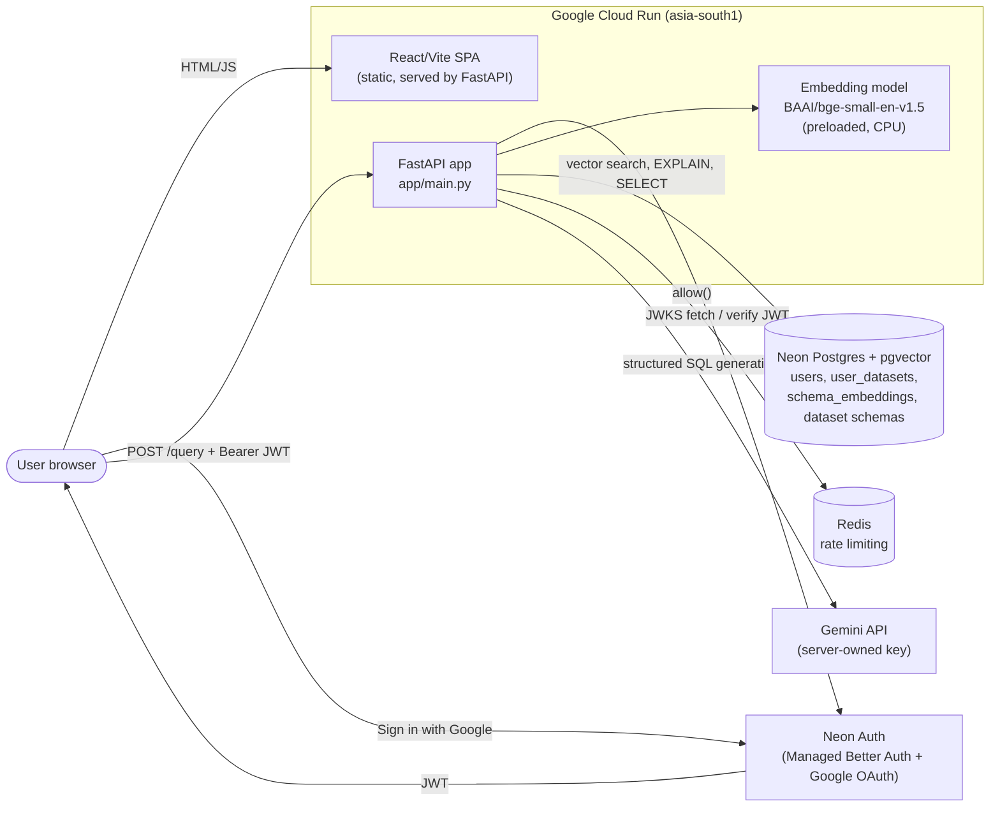
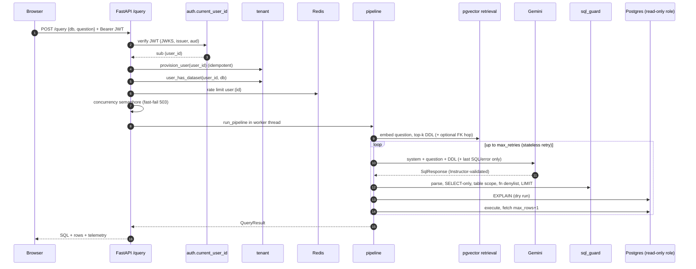
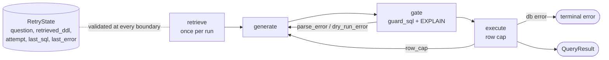
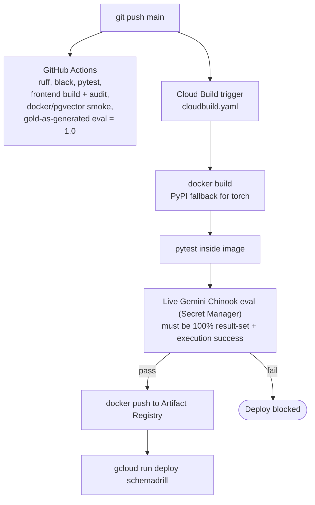
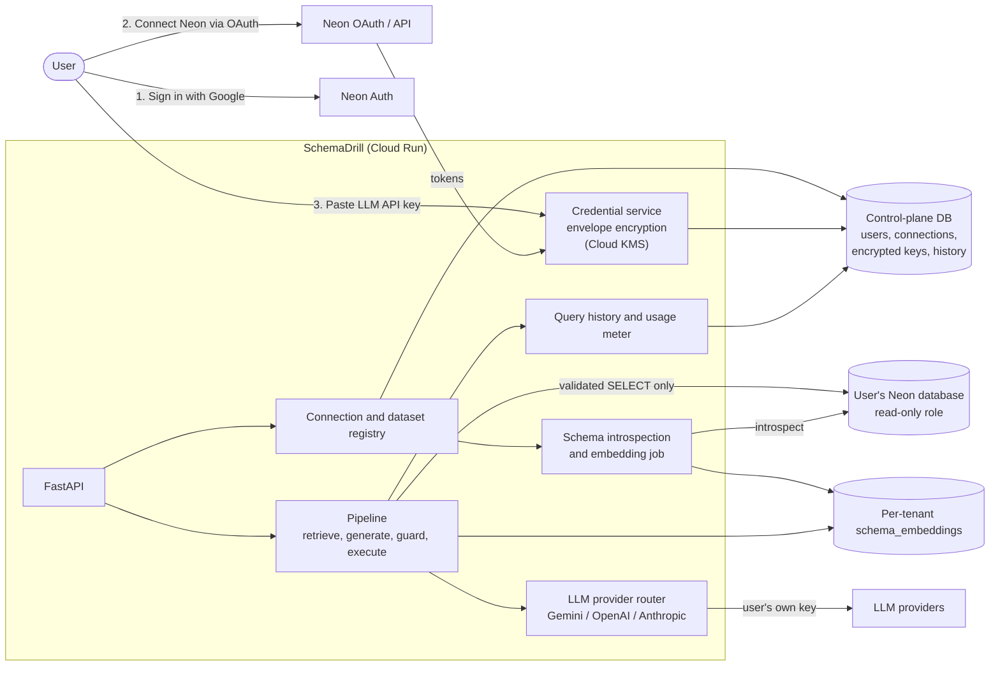

# SchemaDrill Architecture

Status as of 2026-11-07 (`main` at `73d9a4e`). Sections marked **Target** are planned, not shipped.
See [roadmap.md](roadmap.md) for planned work and [changelog.md](changelog.md) for shipped features and bugs solved.

## 1. System context (shipped)



## 2. Request lifecycle (shipped)



## 3. Pipeline stages (shipped)



## 4. Deployment and CI/CD (shipped)



## 5. Data model (shipped)

```mermaid
erDiagram
    users ||--o{ user_datasets : owns
    users {
        text user_id PK "Neon Auth JWT sub"
        text email
        text display_name
        timestamptz created_at
    }
    user_datasets {
        text dataset_id PK
        text user_id PK_FK
        text label
        text schema_name "chinook, ecommerce, organization, complex_synthetic"
    }
    schema_embeddings {
        text schema_name PK
        text table_name PK
        text ddl_text
        vector384 embedding "HNSW cosine"
    }
    user_datasets }o--o{ schema_embeddings : "schema_name"
```

Two DB roles: `schemadrill_readonly` (serving) and `schemadrill_admin` (ingestion and provisioning).

## 6. Architectural decisions (ADR log)

| # | Decision | Why | Trade-off / consequence |
| --- | --- | --- | --- |
| 1 | **FastAPI + Pydantic contracts** at every boundary | Typed, testable, OpenAPI for free | Some validation overhead |
| 2 | **pgvector in the same Postgres** for schema retrieval (behind a `RetrievalProvider` protocol) | One datastore, no extra infra. HNSW cosine is enough for table-level DDL | Qdrant/FAISS are declared but intentionally unimplemented |
| 3 | **Retrieve table DDL, not full schema**; optional one-hop FK expansion and a full-schema baseline | Cuts prompt tokens and is ablatable | FK expansion off by default; recall depends on `top_k=3` |
| 4 | **Stateless retry** (`RetryState` rebuilds the prompt each attempt, keeps only latest SQL/error) | The original loop accumulated messages, so token cost grew per retry | Model does not see older failures |
| 5 | **Pipeline as `RetryState -> RetryState` stages**, validated each boundary | Isolated, testable stages; retrieval fixed across retries | Run-level DataFrame lives in a side context |
| 6 | **Deterministic AST SQL guard** (sqlglot) before `EXPLAIN` | No LLM in the security path. Rejects non-SELECT, multi-statement, out-of-scope tables, dangerous functions, unbounded LIMIT | Generic error messages hide restricted names |
| 7 | **Defense in depth for DB access**: guard + read-only transaction + read-only role + row cap (`max+1`) | A single bypass should not mean data loss | Role also needs write grants on tenant tables (see Known Gaps) |
| 8 | **Result-set accuracy as the primary metric**, AST similarity diagnostic only | AST/"executed OK" misreport correctness. Multiset comparison keeps duplicates | Must be validated against the official BIRD/Spider scorer before publishing numbers |
| 9 | **`eval/` (implementation) vs `evaluation/` (dataset-facing)** | Fast deterministic Chinook CI vs opt-in BIRD | Two namespaces to maintain |
| 10 | **Gold-as-generated CI smoke** + live Gemini gate at deploy | PR CI needs no secrets. Deploy is gated on real model quality | Deploy gate depends on live Gemini availability |
| 11 | **Redis rate limit + in-process concurrency semaphore + provider backoff**, configurable fail-open | Protects Gemini quota and capacity across Cloud Run instances | Redis becomes a runtime dependency |
| 12 | **Single container**: Vite build served by FastAPI `StaticFiles` | One deploy artifact, no CORS | Frontend and API scale together |
| 13 | **Preload embedding model at startup** (default) | Predictable first-query latency | Slower cold start; 2Gi memory |
| 14 | **Offline wheel cache locally, PyPI fallback in Cloud Build** | Local/GHA builds hit broken torch downloads. Cloud Build must not upload 331 MB | Two install paths in the Dockerfile |
| 15 | **Neon Auth (Managed Better Auth, Google provider) with backend JWKS verification** (EdDSA/RS256, issuer and optional audience) | No custom auth server. Stateless, works on scale-to-zero | Issuer needs origin normalization (`fb62b1d`) |
| 16 | **Tenant keyed on JWT `sub`**; lazy idempotent `provision_user` seeds default datasets | No signup webhook needed | First request pays the provisioning cost |
| 17 | **Split provisioning URL**: admin URL used when the serving URL is the read-only role | Read-only role cannot create schemas | Two credentials in config |
| 18 | **Cloud Run Source/Artifact Registry deploy, `min=0`**, Cloud Logging only | Low-cost demo | Cold starts |

## 7. Known gaps and risks (honest list)

- **Tenant isolation is by dataset ACL, not data isolation.** All users share the same physical `chinook`, `ecommerce`, and other schemas. `user_datasets` only controls who may query which `schema_name`. That is fine for read-only demo data but not for user-owned data.
- `schemadrill_readonly` is granted `INSERT/UPDATE/DELETE` on `users` and `user_datasets` (`scripts/tenant.sql`). The SQL guard and read-only transaction mitigate this, but a dedicated writer role is cleaner.
- The Gemini key is **server-owned**: you pay for all usage (the motivation for BYOK).
- Duplicate commits from a rebase (e.g. `c88289a`/`a3870bc`) exist in history. Cosmetic only.

## 8. Target architecture (planned, not implemented)



Design principles for the next iteration:

1. **Control plane vs data plane.** SchemaDrill's own DB stores users, encrypted credentials, registry, history. User data stays in the user's Neon DB and is only touched through a least-privilege read-only role.
2. **BYOK keys are never logged, never returned to the browser after save, and encrypted at rest** (envelope encryption with Cloud KMS; per-user DEK).
3. **Per-request key injection:** the LLM client takes the key as a parameter and not from global settings, so Redis limits and metrics key off `user_id`.
4. **Real multi-tenant isolation:** per-tenant `schema_embeddings` scoped by `(user_id, connection_id)`, and execution on the user's own database rather than a shared one.
5. **SSRF and connection safety:** only Neon-issued hosts, TLS required, statement timeout, row cap, and connection pool per tenant with eviction.
