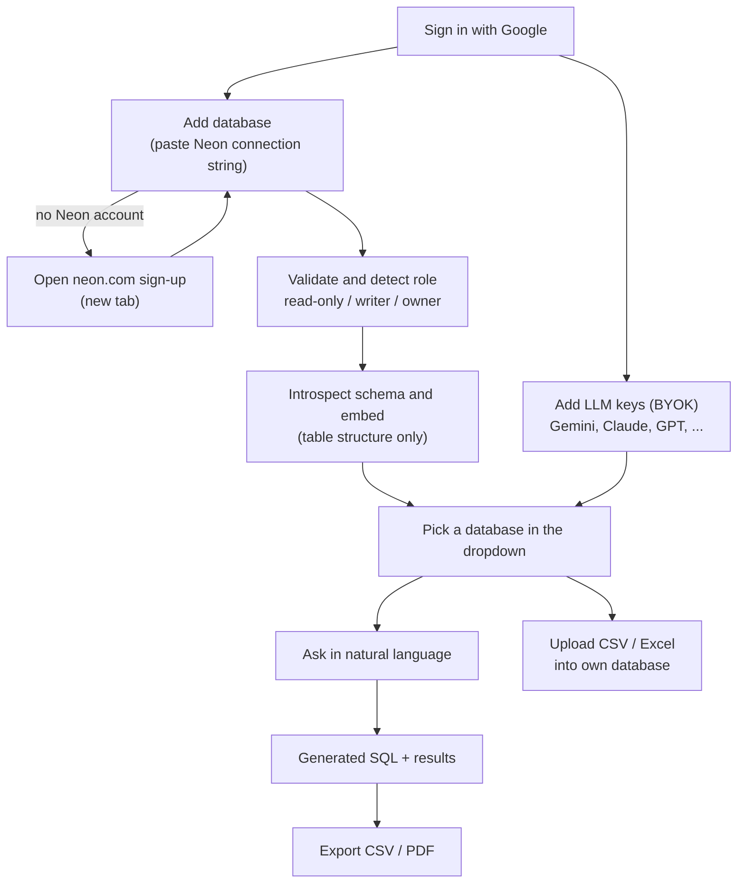

# Roadmap: Planned Features and What's Next

**Product direction:** SchemaDrill moves from a demo over curated datasets to a free platform where
**each user brings their own Neon database (via connection string) and their own LLM keys (BYOK)**.

> SchemaDrill is free and non-commercial. It does **not** use Neon OAuth. See
> [why-no-neon-oauth.md](why-no-neon-oauth.md).

## Target product flow

## Status of the core features

| # | Feature | Status | Reality check against the code |
| --- | --- | --- | --- |
| 1 | **Google authentication** | **Shipped** | Neon Auth with Google, JWT verification, user record with email/display name capture, sign-out and session-expiry UX |
| 2 | **Connect your Neon database** | Planned | Replaces "Neon authorization". Connection-string based, no OAuth. Not started |
| 3 | **BYOK (multi-provider)** | Planned | Gemini key is a global setting today (`app/config.py`) |
| 4 | **Run SQL through the website** | **Partly shipped** | Works on curated shared datasets. Remaining: run on the user's own database |
| 5 | **Search interface and dataset selector** | **Mostly shipped** | Dropdown and examples exist. Remaining: list the user's own databases |
| 6 | **CSV / PDF export** | Partly shipped | CSV export is in the frontend. PDF is not started |
| 7 | **CSV / Excel upload** | Planned | New tables first |

## Phases

### Phase 1: Foundation for tenancy
- [ ] Control-plane tables: `connections`, `credentials`, `llm_keys`, `query_history`, `usage`.
- [ ] Separate writer role (`schemadrill_app`) for control-plane tables (`scripts/tenant.sql` write grants removed from `schemadrill_readonly` in v0.3.1).
- [ ] Move secrets to Secret Manager. Remove plain env reads in `cloudbuild.yaml`.
- [ ] Per-request LLM credentials: `llm_client` and `pipeline` take `provider`, `model`, `api_key`.
- [ ] Key `schema_embeddings` by `(user_id, connection_id)`.
- [ ] Encryption service (Cloud KMS envelope encryption) shared by connections and LLM keys.

### Phase 2: Connect your Neon database (connection string)
User guide: [wiki/connect-neon.md](wiki/connect-neon.md).
- [ ] `POST/GET/DELETE /api/connections`. The string is write-only: the API returns the host, database, role, access level, and status, never the password.
- [ ] Validation: TLS required, host must be a Neon domain (SSRF protection), connect timeout, statement timeout.
- [ ] **Access detection:** inspect the role (owner / writer / read-only) and show it to the user.
- [ ] **Owner warning:** recommend a dedicated read-only role. Optionally use the owner string once to create safe roles, without storing it.
- [ ] Stored encrypted until the user deletes it.
- [ ] **Health and expiry handling:** if a saved connection fails (password reset, role/project/database deleted, suspended), mark it `needs_reconnect`, show a clear message, and keep other connections working.
- [ ] Wake-up handling for scale-to-zero databases (retry with a "waking up your database" message).
- [ ] Schema introspection and embedding on connect, a manual re-sync button, and schema-drift detection.
- [ ] Database dropdown backed by saved connections (curated demos stay as a sandbox option).
- [ ] **Sign-up redirect (no OAuth):** "Create a free Neon account" link that opens neon.com in a new tab, with a "Come back and paste your string" step.
- [ ] In-app help linking to the connect wiki, with screenshots.

### Phase 3: BYOK, multiple LLM providers
User guide: [wiki/byok-keys.md](wiki/byok-keys.md).
- [ ] `POST/GET/DELETE /api/llm-keys`. Write-only, returns provider, label, last 4 characters, status.
- [ ] Provider interface with **Gemini first**, then **Anthropic Claude** and **OpenAI GPT**, then OpenRouter or any OpenAI-compatible endpoint.
- [ ] Model selection per provider and a default key.
- [ ] Validate on save with a cheap test call.
- [ ] **Key health states:** `active`, `invalid` (expired/revoked), `rate_limited`, `out_of_quota`, `degraded`.
- [ ] **Graceful catch-up:**
  - [ ] Backoff and retry on rate limits.
  - [ ] Optional **fallback order** across the user's saved keys.
  - [ ] Pause out-of-quota keys and tell the user which one.
  - [ ] Failed questions are kept so the user can fix the key and press **Retry** without retyping.
- [ ] Redact keys in logs and errors, with tests.
- [ ] Per-user and per-key usage tracking and rate limits.

### Phase 4: Query the user's database and export
- [ ] Run the pipeline (retrieve, generate, guard, `EXPLAIN`, execute) against the user's connection.
- [ ] Allowed tables derive from introspection. Keep the AST guard, read-only transaction, statement timeout, and row cap.
- [ ] Show generated SQL and results clearly. Editable SQL goes back through the guard.
- [ ] **CSV export** (already in the frontend) with CSV formula-injection protection.
- [ ] **PDF export** of results (server-side, with a row cap).

### Phase 5: Write path (CSV / Excel upload)
Writes are an explicit upload feature. The LLM never generates data-changing statements.
- [ ] Separate **writer credential**, never reused for reads. Detect whether the saved role can write.
- [ ] Upload wizard: file size limits, parse CSV/XLSX, preview, type inference, column mapping.
- [ ] **New tables first.** Appending to existing tables later.
- [ ] Transactional load (`COPY` or batched), dry-run summary, explicit confirmation, rollback on error.
- [ ] Re-introspect and re-embed after any schema change.

### Phase 6: Extensions (discussed ideas, not commitments)
- [ ] Query history and saved queries.
- [ ] Query explanations and optimization hints (using `EXPLAIN` output).
- [ ] Usage dashboard (tokens, estimated cost, quota).
- [ ] Per-user workspaces and sharing.

## Understanding connection strings (not a share link)

A Neon connection string is a **database username and password**, not a Google Drive style link
with permission levels. Access depends on the role in the string: owner (everything), writer,
or read-only. That is why SchemaDrill detects the role's access, recommends a dedicated
read-only role, and keeps any write credential separate. Details in
[wiki/connect-neon.md](wiki/connect-neon.md).

## Cross-cutting risks to design for

| Risk | Mitigation |
| --- | --- |
| Stored connection strings and API keys leaking | KMS envelope encryption, write-only APIs, log redaction, no secrets in errors |
| Owner-level strings pasted by users | Detect and warn, recommend read-only role, optionally use once without storing |
| Cross-tenant data access | Per-connection scoping everywhere (registry, embeddings, pool). Ownership check on every request. Adversarial tests |
| Malicious generated SQL against user DBs | AST guard plus read-only role and transaction, statement timeout, row cap |
| SSRF through user-supplied connection strings | Allow Neon hosts only, require TLS, resolve and validate before connecting |
| Prompt injection from schema or data content | Treat schema text as untrusted. The guard remains the final authority |
| Cost and abuse | Per-user rate limits, concurrency caps, usage metering |
| Dead credentials (expired DB or LLM key) | Health states, `needs_reconnect`, fallback keys, retry without retyping |

## Suggested next step

Start with **Phase 1**, then **Phase 3 (BYOK)**. It removes your Gemini bill and the per-request
credential change is needed before user-owned databases.
