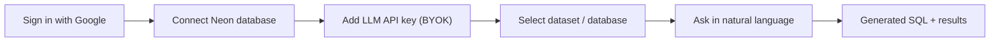

# Roadmap: Planned Features and What's Next

**Product direction:** SchemaDrill moves from a demo over curated datasets to a platform where
**each user brings their own database (Neon) and their own LLM key (BYOK)**. BYOK and user-specific
database connections are the defining features of the next iteration.

## Target product flow

Example: "Show the 10 tracks with the longest duration."

## Status of the five core features

| # | Feature | Status | Reality check against the code |
| --- | --- | --- | --- |
| 1 | **Google authentication** | **Mostly shipped** | Neon Auth with Google provider, JWT verification, and the user record are live. Remaining: profile (email/name) capture into `users`, logout/session-expiry UX, and trusted-origin checks per environment |
| 2 | **Neon authorization** | Planned | Not started. Needs Neon OAuth app, token storage, and project/branch/database listing |
| 3 | **BYOK** | Planned | Not started. Gemini key is a global setting (`app/config.py`) |
| 4 | **Run SQL through the website** | **Partly shipped** | NL to SQL to results works on curated datasets. Remaining: run against the user's own DB |
| 5 | **Search interface and dataset selector** | **Mostly shipped** | Dropdown and example questions exist. Remaining: show generated SQL and results more fully, and list the user's own databases |

## Proposed phases

### Phase 1: Foundation for tenancy (prerequisite)
- [ ] Control-plane tables: `connections`, `credentials`, `query_history`, `usage`.
- [ ] Separate writer role for control-plane tables. Remove write grants from `schemadrill_readonly`.
- [ ] Secrets to Secret Manager. Remove plain env reads in `cloudbuild.yaml`.
- [ ] Refactor `llm_client` and `pipeline` to take per-request `provider`, `model`, and `api_key`.
- [ ] Refactor retrieval and `schema_embeddings` to key on `(user_id, connection_id)`.

### Phase 2: BYOK (feature 3)
- [ ] `POST/GET/DELETE /api/credentials`, write-only (return a fingerprint such as the last 4 characters).
- [ ] Envelope encryption (Cloud KMS plus a per-user data key) and no key logging (redaction filter and tests).
- [ ] Key validation on save (cheap test call) and clear errors for invalid or quota-exhausted keys.
- [ ] Provider and model selection (Gemini first, then OpenAI and Anthropic) via a provider interface.
- [ ] Rate limits and usage tracked per user and per key, not shared.

### Phase 3: Neon authorization and user databases (features 2 and 4)
- [ ] Register a Neon OAuth app. Implement authorize/callback with `state` and PKCE. Store and refresh tokens (encrypted).
- [ ] List projects, branches, and databases. Create a dedicated **read-only role** in the chosen database, so SchemaDrill never uses the owner role.
- [ ] Per-tenant connection manager: TLS required, host allowlist (Neon only), statement timeout, row cap, pooled with idle eviction.
- [ ] **Schema introspection and automatic embeddings** on connect, with a refresh button and a schema-drift check.
- [ ] Run the existing pipeline (guard, `EXPLAIN`, execute) against the user's DB. Allowed tables derive from introspection.

### Phase 4: UX (feature 5)
- [ ] Onboarding wizard: Google, Neon, key, dataset.
- [ ] Dataset/database selector backed by the user's connections (curated demos remain as a sandbox option).
- [ ] Results panel: generated SQL, execution table, timing, retries.
- [ ] Editable generated SQL (re-run through the guard) and CSV export.

### Phase 5: Extensions (discussed ideas, not commitments)
- [ ] Query history and saved queries.
- [ ] Query explanations and optimization hints (using `EXPLAIN` output).
- [ ] Execution limits and usage dashboard (tokens, cost estimate, quota).
- [ ] Bounded self-correction exposed in the UI (attempts shown to the user).
- [ ] Multiple providers and automatic fallback.

## Cross-cutting risks to design for

| Risk | Mitigation |
| --- | --- |
| Stored user API keys leaking | KMS envelope encryption, write-only API, log redaction, no keys in error messages |
| Cross-tenant data access | Per-connection scoping everywhere (registry, embeddings, pool). Ownership check on every request. Adversarial tests |
| Malicious generated SQL against user DBs | Existing AST guard plus read-only role, read-only transaction, statement timeout, row cap |
| SSRF through user-supplied connection strings | Prefer Neon OAuth discovery over raw URLs. If raw URLs are allowed, resolve and allowlist hosts |
| Prompt injection from schema or data content | Treat schema text as untrusted. The guard remains the final authority |
| Cost and abuse | Per-user rate limits, concurrency caps, usage metering |
| Token expiry and revocation (Neon OAuth) | Refresh flow, a "reconnect" state in the UI, and graceful errors |

## Suggested next step

Start with **Phase 1**, then **BYOK**. It is the smallest vertical slice that removes your Gemini bill,
and the per-request credential refactor is needed anyway before user-owned databases.
